# Seven Tools of the Bandit

Sysadmin Swiss-army knife for the M5Stack Cardputer v1
Powered by Shin-Lima_Kun

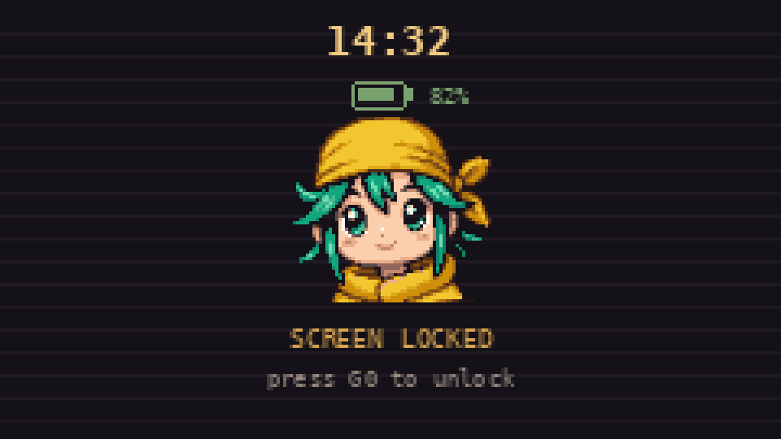 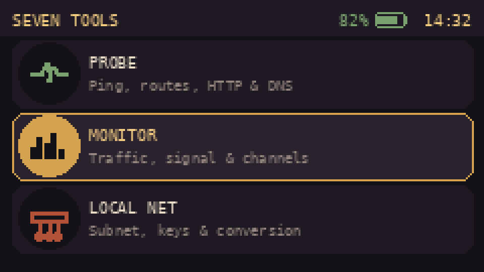

## What is it?

Seven Tools of the Bandit is a firmware for the M5Stack Cardputer v1 that
packs 29 network, diagnostic and administration tools into one pocket-sized
device. Everything is driven from the physical keyboard and shown on the
240×135 px screen, with an earth-tone, old-gold and terminal-green
interface.

The tools are organized into 7 categories: WiFi, Probe, Monitor, Local Net,
USB HID, Files and Server. The whole UI — menus, every tool screen, its
detailed help, and its status/toast messages — switches between Spanish and
English on the fly with the **L** key.

## Requirements and important notes

- **Hardware:** M5Stack Cardputer v1 (ESP32-S3) with a microSD card for the
  file tools, network history and saved networks.
- **USB mode — TinyUSB:** the project needs `ARDUINO_USB_MODE=0` in
  `platformio.ini`. That's the only mode that lets the device act as a USB
  keyboard or mouse (HID); it's different from the "Hardware CDC" mode used
  by other Cardputer projects.
- **microSD pins:** CS=GPIO12, SCK=40, MISO=39, MOSI=14. If your unit
  differs, adjust the `SD_SPI_*` constants in the source.
- **"Ping" is not ICMP:** it measures TCP connection time to a port — a
  good indicator of reachability and latency, but not a strict ping.
- **Packet Monitor:** uses the ESP32's promiscuous mode and only counts
  packets by type (MGMT, DATA, CTRL); it never stores or shows their
  contents.
- **Not yet tested on hardware:** the keyboard/mouse USB mode and the
  monitor and file-explorer modules haven't been tested on a physical
  Cardputer yet — worth double-checking the first time.
- **Responsible use:** port scanning, traceroute and network monitors
  should only be used on your own networks or with explicit authorization.

## General controls

| Key | What it does |
|---|---|
| `; .` | Move the selection (up / down) |
| `ENTER` | Choose or activate |
| `` ` `` | Back or exit |
| `i` | Help for the current screen (every module has its own) |
| `M` | Mute or unmute sound |
| `L` | Switch language ES/EN (on the launcher or a submenu) |
| `G0` | Lock or unlock the screen and keyboard without pausing what's running |

The lock screen shows the time (NTP if there's internet, or "+hh:mm" since
power-on), the battery level, and Raimu, the project's mascot, with a
gentle idle sway. Scans, monitors and the file server keep running in the
background while it's locked. Pressing **ENTER** or any arrow key while
locked makes Brisa — the author's own dog, from a separate Cardputer
project — run across the bottom of the screen for a few loops, without
unlocking the device.

 

## 1 · WIFI

Nearby networks, connecting, saved networks, and duplicate-name alerts.

| Tool | What it does |
|---|---|
| WiFi Scan | Lists nearby networks with signal (RSSI) and channel. ENTER connects; K marks a password already saved on the SD, and ! flags an SSID used by two routers. |
| Network Info | Shows IP, mask, gateway, DNS, MAC and signal. C reconnects to the last network; D disconnects. |
| Saved Networks | Manages the passwords in `7tools.cfg` on the microSD and lets you forget a network (with confirmation). The password is never shown. |
| Twin Alert | Detects repeated WiFi names with a different router MAC: `[!]` different encryption (suspicious), `[?]` a saved network, `[i]` probably a mesh. Only listens; never creates networks. |
| Network History | Networks seen in your scans with their last signal and time, saved in `/7seen.cfg` (up to 40). |

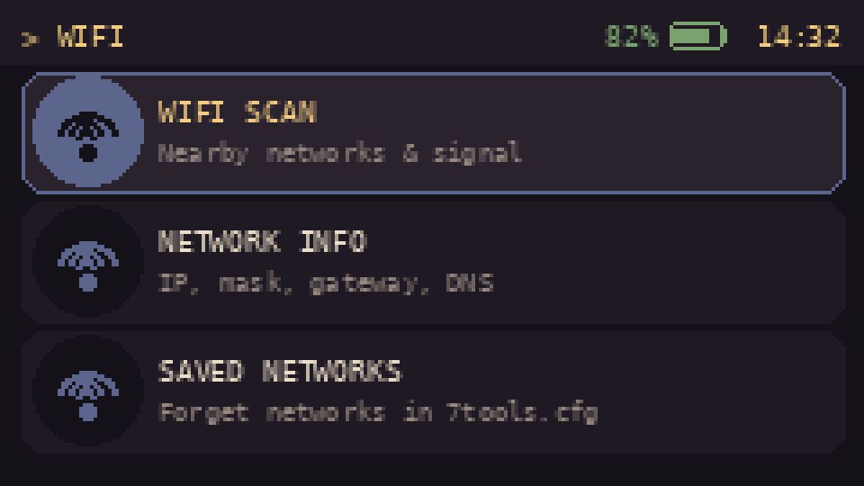 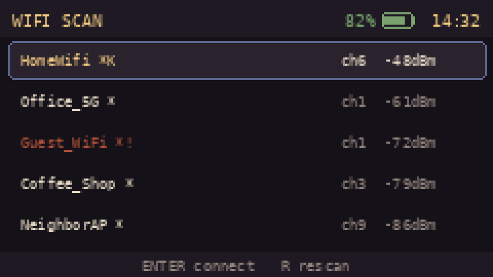

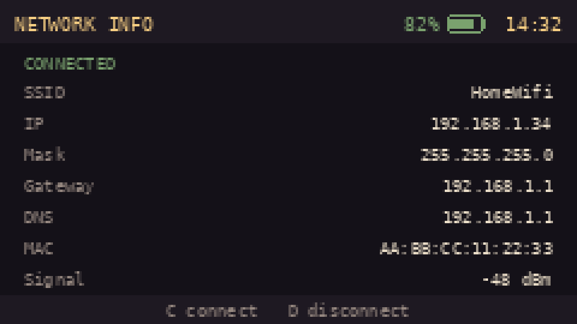

## 2 · PROBE

Reachability and diagnostic tests against a host, a URL, or a name.

| Tool | What it does |
|---|---|
| Ping (TCP) | Measures TCP connection latency to host:port (80 by default) over 6 attempts. |
| Port Scan | Tests 16 common TCP ports against a host and flags the open ones. |
| Traceroute | Shows the hops to a host using ICMP packets with increasing TTL (up to 20). `*` means that hop didn't reply. |
| HTTP Client | Sends a GET to a URL and shows the status code and headers, without downloading the body. Doesn't validate the certificate over HTTPS. |
| DNS | Resolves a name to an IP, or looks up the reverse name (PTR) of an IP, using your network's DNS. |

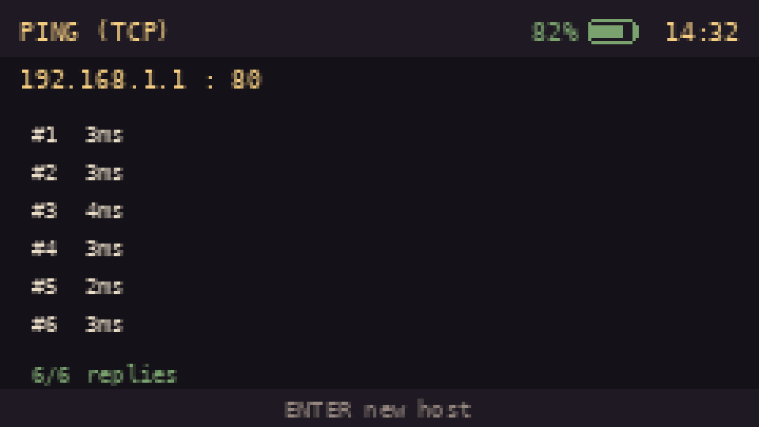 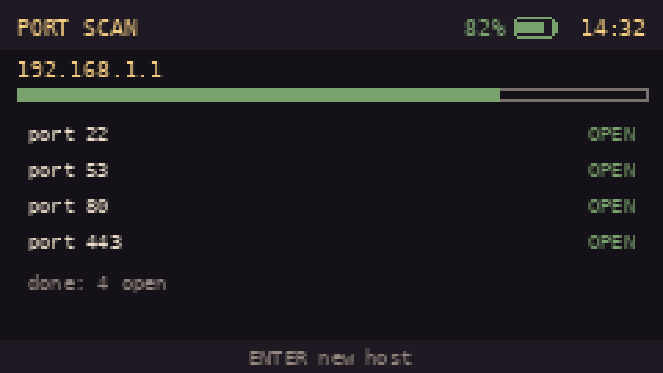

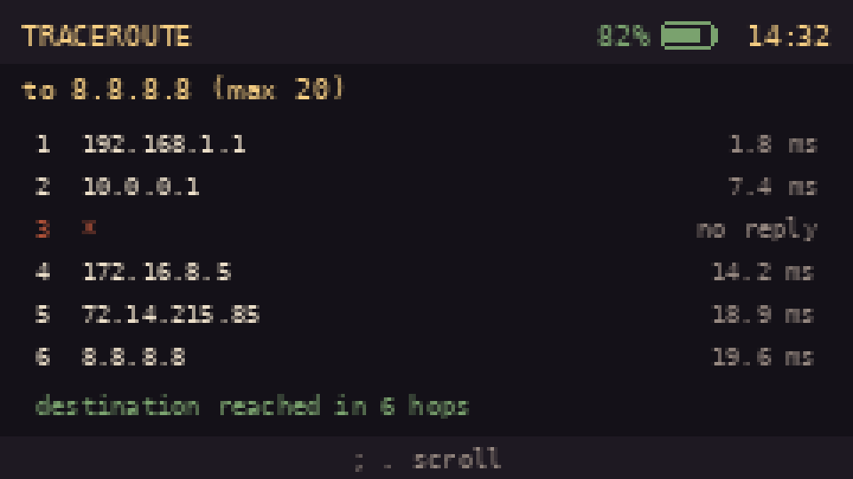

## 3 · MONITOR

Traffic, signal and WiFi channel occupancy.

| Tool | What it does |
|---|---|
| Packet Monitor | Stacked graph of WiFi traffic per second (MGMT, DATA, CTRL), on a fixed channel or auto-hopping (HOP). Count only; stores no data. |
| WiFi Channels | Counts networks per channel (1-13) and suggests the best of 1, 6 and 11. |
| Device Count | Counts how many distinct devices are talking to a chosen network. Doesn't store or show MACs: uses a temporary, randomly-salted hash. |
| Live Signal | Real-time graph of a network's signal; walk around and watch where it rises. Optional tone (higher pitch = stronger). |
| Free Channel | Measures each channel's actual traffic combined with neighboring networks to suggest the best channel for your own AP. |

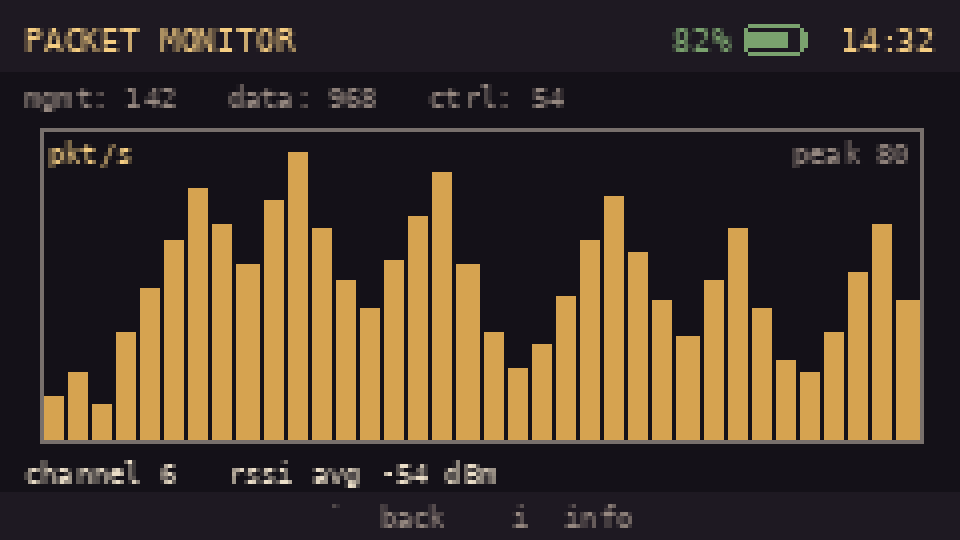 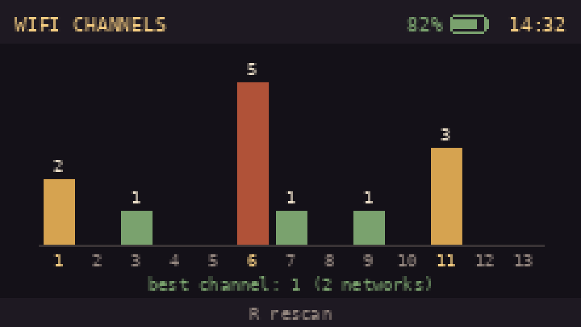

## 4 · LOCAL NET

Address calculation, validation and conversion, plus network utilities.

| Tool | What it does |
|---|---|
| Subnet Calc. | Given an IP/CIDR, calculates network, broadcast, mask, usable range and host count. Doesn't need WiFi. |
| Wake on LAN | Sends a "magic packet" to power on a remote machine from its MAC. |
| Password Generator | Generates random passwords with the chip's RNG, with length, symbols, numbers and "no confusing characters" to taste. Shows the bits of entropy and saves nothing. |
| Range Check | Checks whether an IP falls inside a subnet (CIDR or with a mask) and flags the network address or the broadcast. |
| IP Converter | Converts an IP between decimal, binary, hex and integer, and shows its type (private, public, loopback...). |

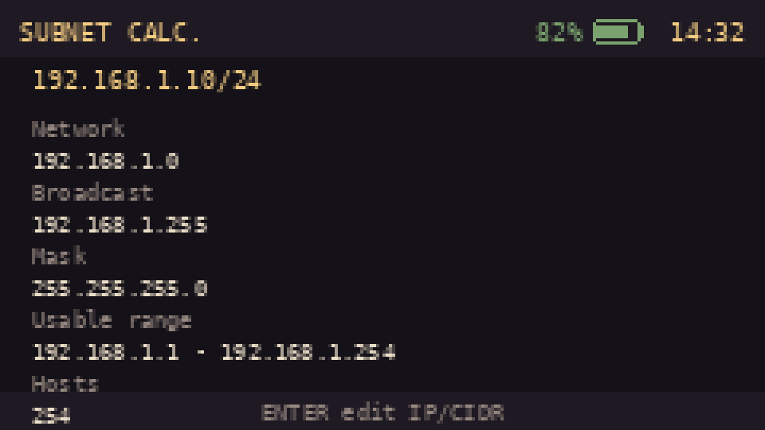 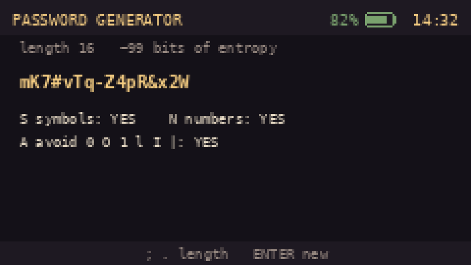

## 5 · USB HID

The Cardputer connects over USB to a PC and acts as a keyboard, mouse, or
remote control.

| Tool | What it does |
|---|---|
| USB Keyboard | What you type is sent to the PC as a real keyboard (ENTER and DEL included). Exit by pressing `` ` `` three times in a row. |
| USB Mouse | `; . , /` move the cursor, faster if held. ENTER is left click, DEL is right click. |
| Keyboard Combos | Sends shortcuts (Ctrl+Alt+Del, Win+L, Alt+Tab, Ctrl+C/V...) with a single ENTER. |
| Presenter | Remote slide control: next/previous, start (F5), end (Esc), black or white screen, and a timer. |

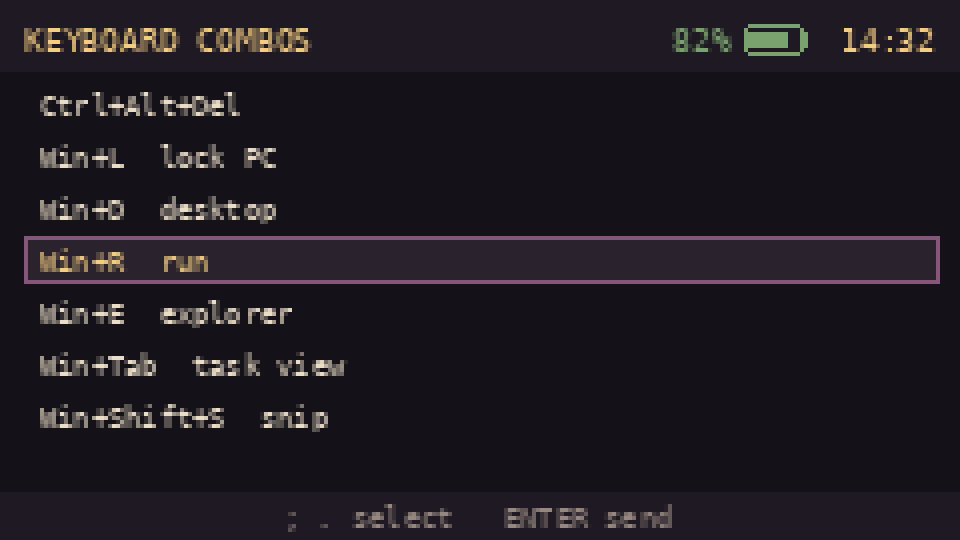 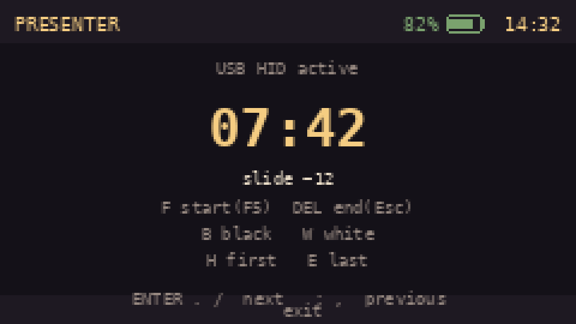

## 6 · FILES

Manages the microSD directly from the device.

| Tool | What it does |
|---|---|
| SD Explorer | Browse folders and files with a text preview. N new folder, F new file, R rename, D delete (confirms), C copy, X cut, P paste, W send over WiFi. |
| SD Space | Shows card type, capacity, and how much space is used and free. |

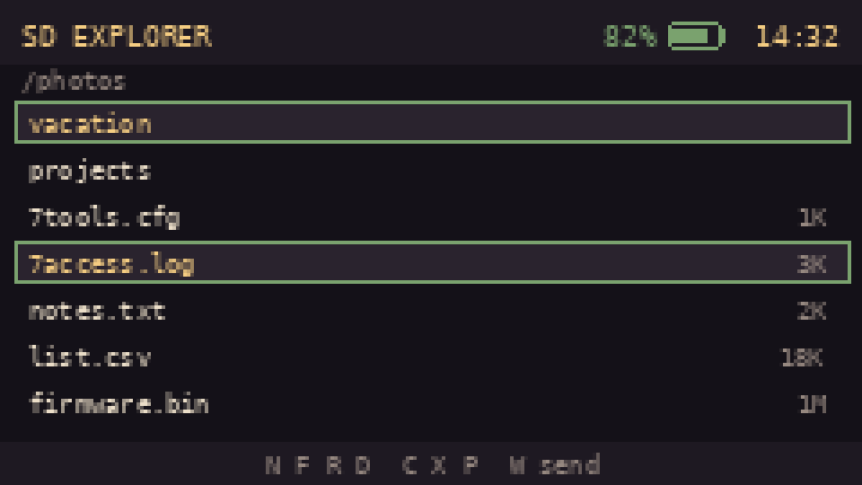 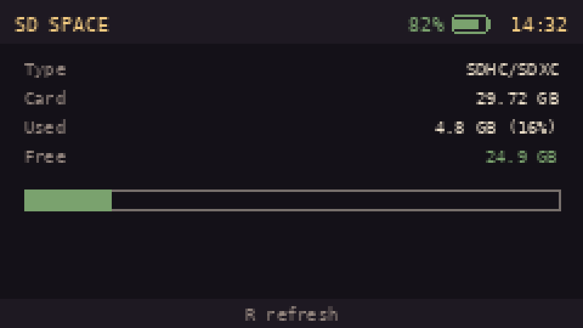

## 7 · SERVER

Serves the microSD as a website to upload and download files from a phone
or PC.

| Tool | What it does |
|---|---|
| Own Network (AP) | Creates its own password-protected WiFi and serves the SD. Supports uploading, downloading and deleting files from the web. Q shows a QR code to join and open the site. |
| On My Network (STA) | Serves the SD on the WiFi you're already connected to. Supports uploading and downloading; web-based deleting is disabled in this mode. |
| Access Log | Viewer for `/7access.log`: every upload, download or delete is logged with time, IP and path. |

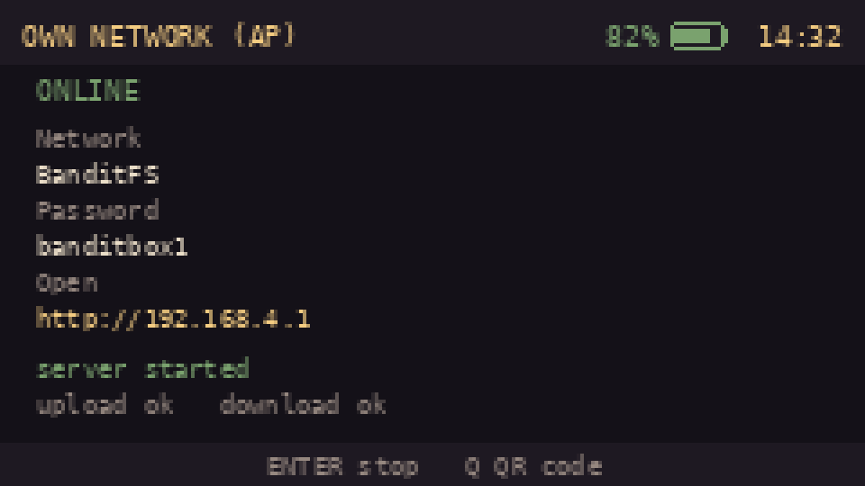

**Recommendation:** change the default AP name and password (the `fsSSID`
and `fsPass` variables in the source) before publishing or using the
firmware in a shared environment.

## Mascot: Raimu

Raimu, the lock-screen mascot, is an original chibi character designed by
Shin-Lima_Kun: yellow headscarf, teal-green hair, big eyes. It's drawn as a
61×57 px sprite with 17 colors, embedded directly in the code with no image
files needed.

## What's deliberately *not* here

Earlier in development, deauthentication attacks, an Evil-Twin / captive
portal simulator, and a WiFi probe-sniffer (which tracks nearby device
owners) were requested and turned down: those are attack/interference and
non-consensual-tracking tools, not diagnostics, regardless of "educational"
or "own network" framing. The Packet Monitor tool only counts
management/data/control packet *types* on the current channel — it never
inspects packet contents or targets a specific device.

---

*Note: the screenshots in this document are representations of the
interface generated from the firmware's drawing code (real resolution
240×135 px), with example data.*

See [`README.md`](README.md) for the pre-built `.bin` releases and build
instructions.
